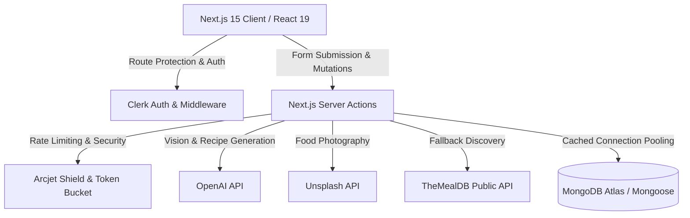

# 🍳 Served — AI Recipe Platform & Smart Kitchen Assistant

[](https://nextjs.org/)
[](https://react.dev/)
[](https://www.mongodb.com/)
[](https://tailwindcss.com/)
[](https://clerk.com/)
[](https://arcjet.com/)

**Served** is a full-stack, AI-powered culinary companion designed to eliminate food waste and simplify home cooking. Users can snap a photo of their pantry or fridge to automatically detect ingredients, generate chef-crafted recipes tailored precisely to on-hand ingredients, bookmark favorites to a personal digital cookbook, and export complete cooking guides as print-ready PDF cards.

---

## 🌟 Key Features

- **📸 AI Vision Pantry Scanner:** Upload photos of your fridge or pantry to automatically detect and extract food ingredients using OpenAI's multimodal vision model.
- **🥗 Pantry Inventory Management:** Full CRUD management for pantry ingredients with quantity tracking and instant ingredient-based recipe recommendations.
- **🤖 On-Demand AI Recipe Generator:** Enter any dish name or let the AI recommend recipes based on your pantry stock with prep/cook time, detailed instructions, nutrition facts, chef tips, and smart ingredient substitutions.
- **🌍 Global Recipe Discovery:** Explore curated dishes across 21 international cuisines and meal categories (breakfast, lunch, dinner, dessert, snacks), featuring a daily "Recipe of the Day" powered by MongoDB with a fallback to TheMealDB.
- **📖 Personal Digital Cookbook:** Save and organize favorite recipes with one-click bookmarking powered by MongoDB compound indexing.
- **📄 Print-Ready PDF Cooking Cards:** Export beautifully formatted, multi-page culinary instruction cards using `@react-pdf/renderer` for offline cooking.
- **🖼️ Automated High-Definition Food Imagery:** Dynamic image pairing for AI-generated recipes via the Unsplash API.
- **🛡️ Enterprise-Grade Security:** Layered bot protection, rate limiting, and WAF shield powered by Arcjet, paired with Clerk authentication.

---

## 🏗️ Architecture Overview

The platform is built using a modern **Next.js 15 App Router** architecture leveraging **Server Actions** for secure, low-latency, and server-rendered data flows:



### Database Models (Mongoose)
- **`User`**: Synchronizes Clerk authenticated profiles (`clerkId`, `email`, `username`, `subscriptionTier`).
- **`PantryItem`**: User-isolated pantry items (`name`, `quantity`, `imageUrl`, indexed by `userId`).
- **`Recipe`**: Public and community recipe library storing instructions, ingredients, nutrition facts, substitutions, and metadata.
- **`SavedRecipe`**: User bookmark collection with compound unique indexes (`userId` + `recipeId`) and virtual population.

---

## 💻 Tech Stack

| Layer | Technologies |
|---|---|
| **Framework** | [Next.js 15](https://nextjs.org/) (App Router, Server Actions, Server Components) |
| **Frontend UI** | [React 19](https://react.dev/), [Tailwind CSS v4](https://tailwindcss.com/), [tw-animate-css](https://www.npmjs.com/package/tw-animate-css) |
| **Component Primitives** | [Radix UI](https://www.radix-ui.com/), [Base UI](https://base-ui.com/), [Sonner](https://sonner.emilkowal.ski/), [Lucide React](https://lucide.dev/) |
| **Database & ODM** | [MongoDB Atlas](https://www.mongodb.com/atlas) with [Mongoose](https://mongoosejs.com/) (Serverless Connection Caching) |
| **Authentication** | [Clerk](https://clerk.com/) |
| **AI & Multimodal** | [OpenAI API](https://openai.com/) |
| **Security & Rate Limiting**| [Arcjet](https://arcjet.com/) (Shield WAF, Bot Detection, Token Bucket) |
| **External APIs** | [Unsplash API](https://unsplash.com/developers), [TheMealDB](https://www.themealdb.com/) |
| **Document Generation** | [@react-pdf/renderer](https://react-pdf.org/) |

---

## ⚙️ Environment Variables Setup

Create a `.env` file in the `frontend/` directory by copying `.env.example`:

```bash
cp .env.example .env
```

Fill in the required credentials:

```env
# Clerk Authentication
NEXT_PUBLIC_CLERK_PUBLISHABLE_KEY=pk_test_...
CLERK_SECRET_KEY=sk_test_...
NEXT_PUBLIC_CLERK_SIGN_IN_URL=/sign-in
NEXT_PUBLIC_CLERK_SIGN_UP_URL=/sign-up

# Database (MongoDB Atlas)
MONGODB_URI=mongodb+srv://<username>:<password>@cluster0.mongodb.net/ai-recipe-platform?retryWrites=true&w=majority

# Security & Rate Limiting (Arcjet)
ARCJET_KEY=ajkey_...
NEXT_PUBLIC_ARCJET_KEY=ajkey_...

# Unsplash API (Recipe Photos)
UNSPLASH_ACCESS_KEY=your_unsplash_access_key
UNSPLASH_SECRET_KEY=your_unsplash_secret_key

# OpenAI API (Recipe & Vision)
OPENAI_API_KEY=sk-proj-...
```

---

## 🚀 Getting Started Locally

### 1. Prerequisites
- **Node.js**: v18.18+ or v20+ recommended
- **npm** or **pnpm**
- A free **MongoDB Atlas** cluster URI
- A **Clerk** application and **OpenAI** API key

### 2. Install Dependencies
```bash
cd frontend
npm install
```

### 3. Run Development Server
```bash
npm run dev
```
Open [http://localhost:3000](http://localhost:3000) to view the application.

### 4. Optional: Seed Recipe Database
To seed the MongoDB database with initial public recipes:
```bash
node scripts/importRecipes.js
```

---

## 🧪 Quality & Production Verification

Verify code quality with ESLint:
```bash
npm run lint
```

Build the optimized production bundle:
```bash
npm run build
```

Start the production server:
```bash
npm run start
```

---

## 🚢 Deployment to Vercel

1. Push your repository to **GitHub**.
2. Log in to [Vercel](https://vercel.com/) and click **Add New Project**.
3. Select your repository and configure:
   - **Framework Preset:** `Next.js`
   - **Root Directory:** `frontend`
4. Add all environment variables from `.env.example` to the Vercel **Environment Variables** settings.
5. In your **MongoDB Atlas** dashboard, ensure **Network Access** includes `0.0.0.0/0` (Allow Access from Anywhere) so Vercel's serverless functions can connect.
6. Click **Deploy**.

---

## 📸 Screenshots & Showcase

| Dashboard & Pantry | AI Recipe Generator | PDF Recipe Card |
|:---:|:---:|:---:|
| *(Add Dashboard screenshot here)* | *(Add Recipe view screenshot here)* | *(Add PDF view screenshot here)* |

---

## 📄 License
This project is private and developed for portfolio and technical showcase purposes.
